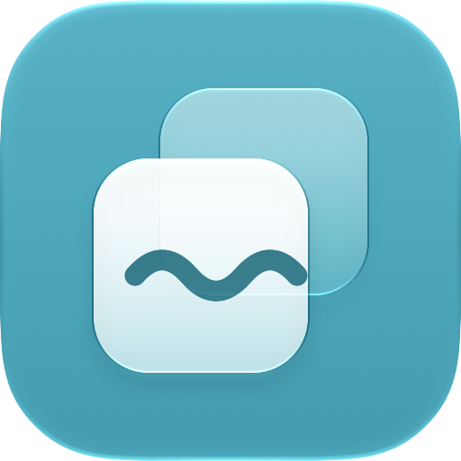
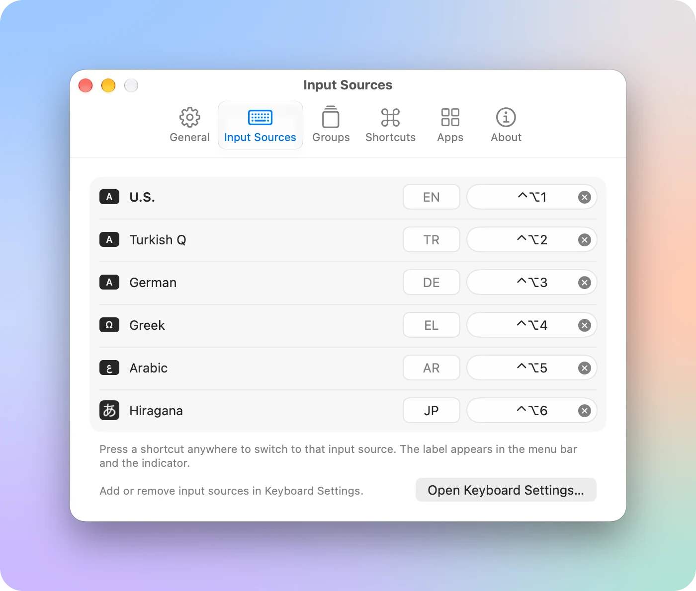
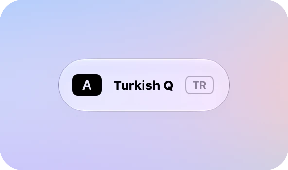
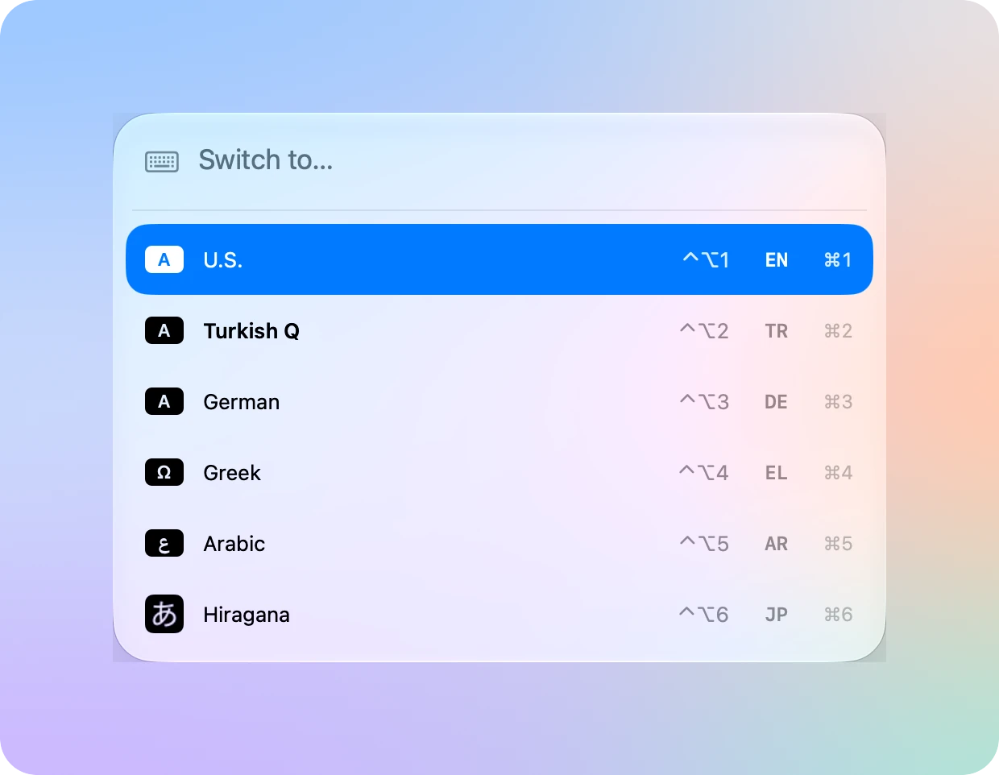
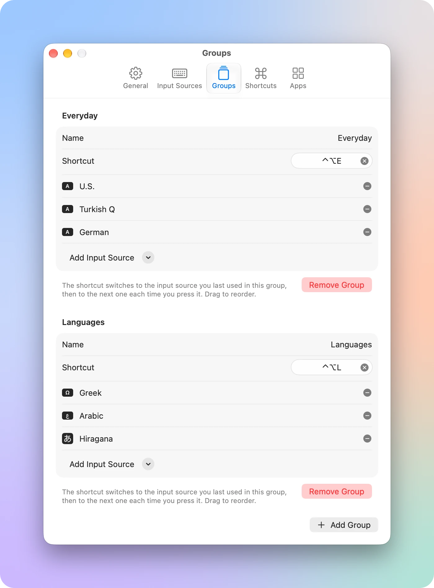
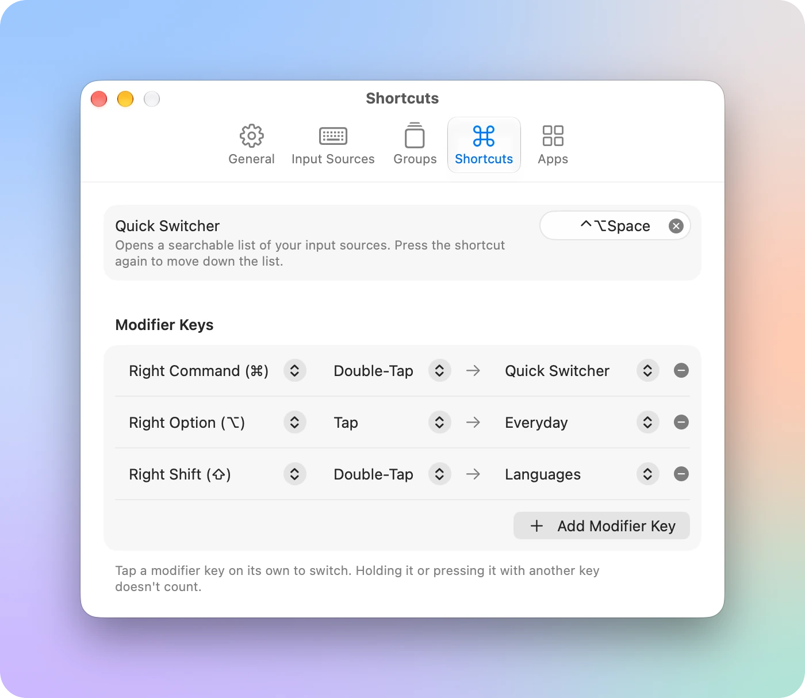
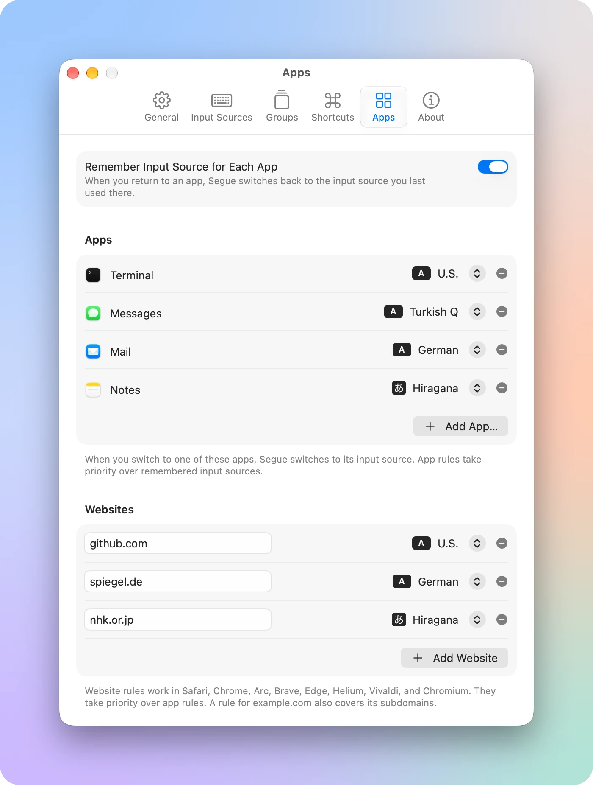

<p align="center">
  <picture>
    <source media="(prefers-color-scheme: dark)" srcset=".github/assets/icon-dark.png">
    
  </picture>
</p>

<h1 align="center">Segue</h1>

<p align="center">Switch input sources without breaking your flow.</p>

<p align="center">
  <a href="https://github.com/firatciftci/segue/releases/latest"><b>Download for macOS</b></a>
  &nbsp;·&nbsp;
  <a href="https://github.com/firatciftci/segue/actions/workflows/ci.yml"></a>
</p>

<p align="center">
  <picture>
    <source media="(prefers-color-scheme: dark)" srcset=".github/assets/sources-dark.webp">
    
  </picture>
</p>

Segue lives in your menu bar and shows which input source you're typing with. Give each input source its own keyboard shortcut, tap a modifier key to switch, or let Segue pick the right one when you move to another app or website. If you type in more than one language, you stop reaching for the Input menu.

## Highlights

### A shortcut for every input source

Press a shortcut anywhere to jump straight to an input source instead of cycling through all of them with Control-Space. Each one gets a short label, like EN or JP, that shows in the menu bar.

When you switch, a small indicator shows where you landed. You can put it at the top right, in the center, or at the bottom of the screen, or turn it off.

<p align="center">
  <picture>
    <source media="(prefers-color-scheme: dark)" srcset=".github/assets/indicator-dark.webp">
    
  </picture>
</p>

### Quick switcher

Press one shortcut to open a searchable list of your input sources. Type a few letters of a name, label, or language, then press Return. Press the shortcut again to move down the list, or press ⌘1 through ⌘9 to pick one directly.

<p align="center">
  <picture>
    <source media="(prefers-color-scheme: dark)" srcset=".github/assets/switcher-dark.webp">
    
  </picture>
</p>

### Groups and modifier keys

A group cycles through a few input sources with one shortcut. It starts with the one you used last, so switching back and forth between two layouts takes a single key press.

You can also tap or double-tap a modifier key on its own, like Right Command or Right Option, to switch to an input source, cycle a group, or open the quick switcher.

<table>
  <tr>
    <td>
      <picture>
        <source media="(prefers-color-scheme: dark)" srcset=".github/assets/groups-dark.webp">
        
      </picture>
    </td>
    <td>
      <picture>
        <source media="(prefers-color-scheme: dark)" srcset=".github/assets/shortcuts-dark.webp">
        
      </picture>
    </td>
  </tr>
</table>

### The right input source for each app and website

Segue can remember the input source you last used in each app and switch back to it when you return. For apps and websites where you always type the same way, add a rule: U.S. in Terminal, Turkish in Messages, Japanese on nhk.or.jp. Website rules work in Safari, Chrome, Arc, Brave, Edge, Helium, Vivaldi, and Chromium.

<p align="center">
  <picture>
    <source media="(prefers-color-scheme: dark)" srcset=".github/assets/apps-dark.webp">
    
  </picture>
</p>

### And more

- Command line: install the `segue` command from Settings to print, list, and switch input sources from Terminal or your scripts.
- URL scheme: open `segue://select/EN`, `segue://cycle/Everyday`, or `segue://switcher` from anywhere that opens links.
- Shortcuts and Siri: switch input sources, cycle groups, and get the current input source in your shortcuts.
- Shortcut conflicts: Segue warns you when a shortcut clashes with another one in Segue or with the input source shortcuts in macOS.
- Settings file: export your settings to a file and import them on another Mac.
- Coming from Kawa: import the shortcuts you set up there with one click.
- Available in English, Chinese (Simplified), French, German, Japanese, Korean, Spanish, and Turkish.

## Install

Segue needs macOS 27 or later.

1. Download `Segue.dmg` from the [latest release](https://github.com/firatciftci/segue/releases/latest).
2. Open it and drag Segue to your Applications folder.
3. Open Segue. To use modifier keys, allow Input Monitoring when macOS asks. To use website rules, allow Segue to control your browser.

Or install it with [Homebrew](https://brew.sh):

```sh
brew tap firatciftci/segue https://github.com/firatciftci/segue
brew install --cask segue
```

Segue updates itself. Every release is signed with a Developer ID, notarized by Apple, and has a build attestation you can check:

```sh
gh attestation verify Segue.dmg --repo firatciftci/segue
```

## Command line

Install the command from Settings > General, then:

```sh
segue                 # Print the current input source ID
segue list            # List enabled input sources with their labels
segue select <query>  # Switch by ID, label, or name, like segue select JP
segue cycle <group>   # Cycle a group
segue switcher        # Open the quick switcher
```

## Privacy

Segue has no accounts, analytics, or servers of its own, and it doesn't record what you type. Input Monitoring only lets it notice when you tap a modifier key on its own. To apply website rules, Segue asks your browser for the address of the front tab, and that address never leaves your Mac. The only network requests are update checks, which go to GitHub.

## Build from source

You need Xcode 27 and [Homebrew](https://brew.sh).

```sh
git clone https://github.com/firatciftci/segue.git
cd segue
brew bundle
xcodegen generate
open Segue.xcodeproj
```

The Xcode project is generated from `project.yml`, so change that file instead of the project settings, and run `xcodegen generate` again. To build without a signing team, pass `CODE_SIGNING_ALLOWED=NO` to `xcodebuild`.

To see sample settings instead of your own, for example when taking screenshots, launch with `-demo`. Add `-light` or `-dark` to pick an appearance. Demo mode doesn't switch your input sources or change your settings.

```sh
open Segue.app --args -demo -dark
```

Before you open a pull request, run the same checks as CI:

```sh
tools/check.sh
```

See [CONTRIBUTING.md](CONTRIBUTING.md) for more.

## Acknowledgments

Segue is inspired by [Kawa](https://github.com/hatashiro/kawa) by hatashiro.

## License

[MIT](LICENSE)
